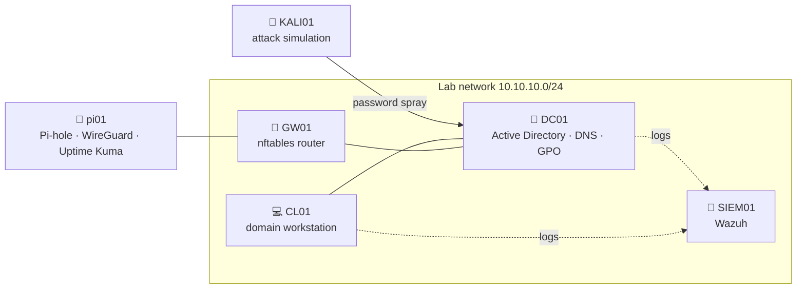

<h1>Hey, I'm Rayan 👋</h1>

<b>Cybersecurity student · future security consultant · homelab builder</b> 
Antwerp, Belgium

  

 

---

## 🧭 At a glance

| | |
|---|---|
| 🎓 **Studying** | Bachelor in Cybersecurity at AP Hogeschool Antwerp, 2nd year |
| 🎯 **Aiming for** | Junior cybersecurity consultant in Belgium |
| 🧪 **Building** | An enterprise-style security homelab for a fictional NIS2 company |
| 💻 **Lab hardware** | MacBook Pro M4 Pro (UTM, all ARM64) + a Raspberry Pi |
| 🗣️ **Languages** | Dutch · English · French · Arabic |
| 🧠 **Interested in** | Identity security, detection, hardening, and turning findings into advice a business can act on |

I like the part where security meets the business: working out what a company actually needs to
protect, finding where it's weak, and explaining the fix so people can act on it. My lab is built
the same way: a fictional client, real configs, a test plan, and a write-up as if I were handing
it over.

---

## 🛡️ Featured project

### [enterprise-security-homelab](https://github.com/rayaneljattari/enterprise-security-homelab) · build in progress

A full small-company network for **Scheldt Logistics NV**, a fictional 60-person logistics firm in
Antwerp that falls under NIS2. I design it, harden it, attack it and check what the SIEM catches.

| Area | What I'm doing |
|---|---|
| **Identity** | AD with department OUs, 60 users provisioned in PowerShell, admin tiering, Windows LAPS, Protected Users |
| **Hardening** | 14-char password policy with lockout, LLMNR and Print Spooler off on the DC, advanced audit policy, before/after check with PingCastle |
| **Detection** | Wazuh agents on the DC and workstation; password spray from Kali should show up as failed-logon alerts |
| **Edge** | nftables router/NAT; Raspberry Pi hardened with ufw, fail2ban, key-only SSH, Docker services |
| **Business side** | Written up for the client: decisions, test plan, and how it maps to NIS2 / CyFun gaps |

Next up: Entra ID hybrid identity with MFA, a NIS2 / CyFun gap assessment, and network segmentation.

---

## 🧰 Stack I'm working with

  
  
  
  
  
   
  
  
  
  
  
  

---

## 📈 Right now

- 🔨 Building the homelab and documenting every step, screenshots included
- 📚 Second year of my cybersecurity bachelor
- 🤝 Open to internships and student jobs in cybersecurity in Belgium. [Connect with me on LinkedIn](https://www.linkedin.com/in/rayan-el-jattari-41a6353a2)

 
Harden it · Attack it · Detect it · Document it

