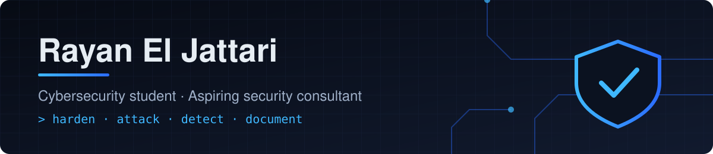
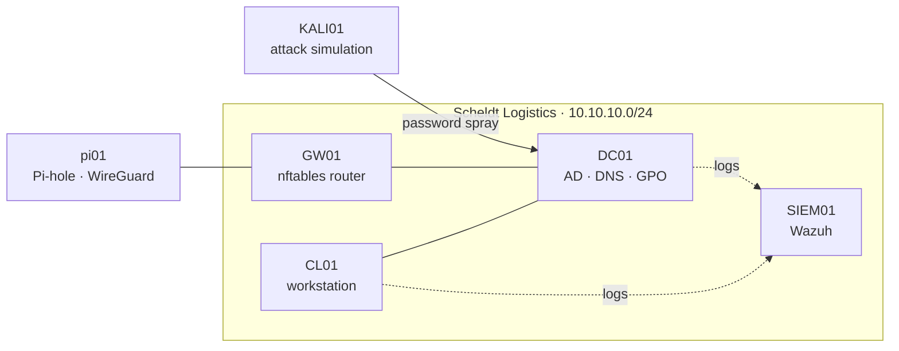

<h1>👋 Hey, I'm Rayan El Jattari</h1>

<b>Cybersecurity Student · Aspiring Security Consultant · Homelab Builder</b>

I build small company networks at home, harden them, attack them, and write up what I find as if a client were reading it.

 

  

 

**Jump to:** 🧭 [At a glance](#-at-a-glance) · 🛡️ [Projects](#%EF%B8%8F-projects) · 🧪 [Home lab](#-home-lab-stack) · 🧰 [Toolbox](#-toolbox) · 🗺️ [Roadmap](#%EF%B8%8F-roadmap)

---

## 🧭 At a glance

| | |
|---|---|
| 🎓 **Education** | Bachelor in Cybersecurity at AP Hogeschool Antwerp, 2nd year |
| 🎯 **Goal** | Junior cybersecurity consultant in Belgium: helping organisations understand their risks and fix them |
| 🏢 **Lab scenario** | Scheldt Logistics NV, a fictional 60-person company in Antwerp that falls under NIS2 |
| 💻 **Hardware** | MacBook Pro M4 Pro running ARM64 VMs in UTM, plus a Raspberry Pi for edge services |
| 🔍 **Focus** | Identity security (Active Directory), hardening, detection with a SIEM, and clear reporting |
| 🗣️ **Languages** | Dutch · English · French · Arabic |

I'm most interested in where security meets the business: working out what an organisation actually needs to protect, finding where it's weak, and turning that into advice people can act on. Every project here is written up with that in mind.

---

## 🛡️ Projects

| Project | What it does | Status |
|---|---|---|
| [**enterprise-security-homelab**](https://github.com/rayaneljattari/enterprise-security-homelab) | Full small-company network: Active Directory with admin tiering and hardening, Wazuh SIEM, attack simulation from Kali, hardened Raspberry Pi. Delivered like a client engagement with scripts, configs, a test plan and business impact. | 🟡 Build in progress |

More projects will be added here as I build them.

---

## 🧪 Home lab stack

### 🏢 Identity
- Windows Server 2025 domain controller with DNS and Group Policy
- Department OU structure, 60 users provisioned with PowerShell
- Admin tiering, Windows LAPS, Protected Users

### 🔒 Hardening
- 14-character password policy with lockout, no forced expiry
- LLMNR and Print Spooler disabled on the DC, advanced audit policy
- Before/after measurement with PingCastle

### 📡 Detection
- Wazuh SIEM on Ubuntu with agents on the DC and workstation
- Authorised attack simulation from Kali to test what gets detected

### 🌐 Network & edge
- Debian router with nftables and NAT
- Raspberry Pi with Pi-hole, WireGuard and Uptime Kuma in Docker, hardened with ufw, fail2ban and key-only SSH

---

## 🧰 Toolbox

  
  
  
  
  
  
  
  
  
  
  

---

## 🗺️ Roadmap

- [ ] Finish the homelab build and publish screenshots and results
- [ ] Before/after AD security score with PingCastle
- [ ] Entra ID hybrid identity with MFA and Conditional Access
- [ ] NIS2 / CyFun gap assessment report for the fictional client
- [ ] Network segmentation between attacker, server and client networks

---

### 🤝 Let's connect

I'm looking for internships and student jobs in cybersecurity in Belgium. 
The best way to reach me is on [**LinkedIn**](https://www.linkedin.com/in/rayan-el-jattari-41a6353a2).

 

🛡️ Blue team · 🏢 Active Directory · 📡 SIEM · 🐧 Linux · 🍓 Raspberry Pi · 🇧🇪 Antwerp

